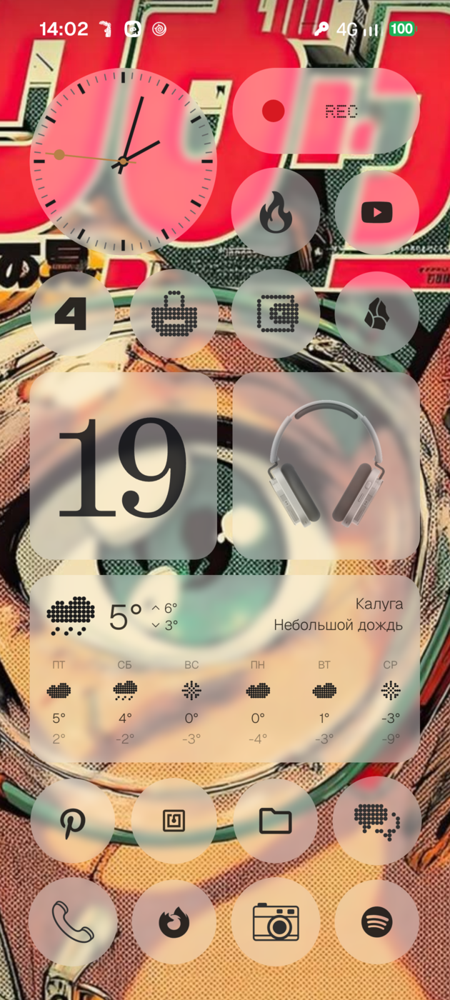
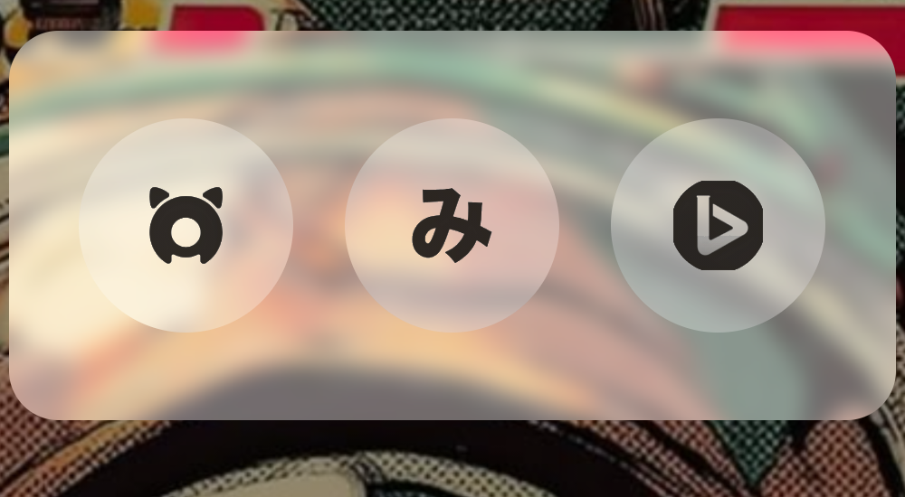
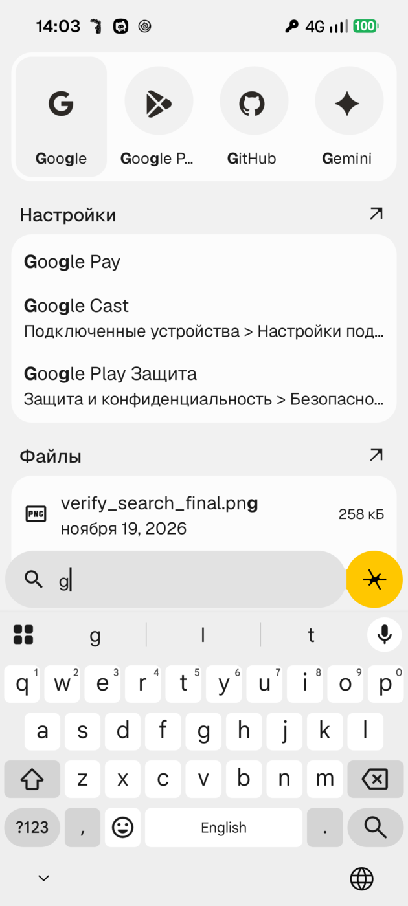

# NothingBlurIcons 🪟✨

[](https://nothing.tech)
[](https://github.com/LSPosed/LSPosed)
[]()
[](LICENSE)

An **Xposed / LSPosed** module for Nothing OS that brings authentic, dynamic **frosted glass wallpaper blur** to home screen and folder app icons — seamlessly matching Nothing OS 5.0 / 3.0 widgets, media player, and weather cards.

---

## 💡 Acknowledgements & Inception (Благодарности)

> [!IMPORTANT]
> **Special thanks to [@linuxct](https://github.com/linuxct)** — the creator of [**nothing-icongen**](https://github.com/linuxct/nothing-icongen).
>
> This project was inspired by and built to work in perfect synergy with **`nothing-icongen`**. 
> While `nothing-icongen` generates the semi-transparent icon bases for Nothing OS, **NothingBlurIcons** hooks directly into Nothing Launcher's native `FrostedBackdropProvider` to render real-time, hardware-accelerated frosted glass wallpaper blur behind each icon.
> 
> **Без работы и задумки `linuxct` появление этого проекта было бы невозможным!**

---

## ✨ Features (Возможности)

- 🪟 **Authentic Frosted Glass Blur:** Hooks directly into Nothing OS's proprietary `FrostedBackdropProvider` and `FrostedBackdropDrawable` — 100% identical in blur radius, lighting, and tint to official Nothing OS widgets (Clock, Weather, Media Player).
- 📁 **Smart Folder Separation:** Icons inside opened folders dynamically receive a soft milky-glass highlight (`0x48FFFFFF` in light mode / `0x2AFFFFFF` in dark mode) so that circular icon plates cleanly stand out from the folder's glass backdrop without blending in.
- 🚀 **Buttery Smooth 120 FPS:** Zero lag or stutter. Highly optimized with frame-rate throttled invalidations (8ms budget), reflection lookup caching, and weak view-type caching. Measured jank rate under 2.0% on Snapdragon SM8735 / Nothing Phone (3).
- 🔍 **Classic Monochrome in All Apps & Search:** Automatically resolves and applies authentic Nothing OS monochrome themed icons in the app drawer and universal search bar with native charcoal/off-white plates.
- 🔄 **Real-Time Wallpaper & Theme Sync:** Reacts instantaneously when switching between Dark/Light themes, paging home screen workspaces, or changing wallpapers.

---

## 📸 Screenshots (Скриншоты)

| Home Screen Blur (Рабочий стол) | Folder Glass Separation (Иконки в папке) |
|:---:|:---:|
|  |  |

| Folder Icons Close-up (Крупный план папки) | Drawer Search Integration (Поиск в меню) |
|:---:|:---:|
|  |  |

---

## 📱 Compatibility (Совместимость)

Requires any Nothing smartphone running **Nothing OS 3.0, 4.0 or 5.0** (Android 15+):

- **Nothing Phone (3)** — Fully tested & verified ✅
- **Nothing Phone (2a) & Phone (2a) Plus** — Fully supported ✅
- **Nothing Phone (2)** — Supported on Nothing OS 3.x, 4.x and 5.0 ports ✅
- **CMF Phone 1** — Supported with Nothing OS 3.0+ / 4.0 ✅
- **Nothing Phone (1)** — Supported on Nothing OS 3.0 ✅

---

## 🛠️ Prerequisites & Installation (Установка)

### 1. Requirements
1. **Root access** via [KernelSU](https://github.com/tiann/KernelSU), [KernelSU-Next](https://github.com/KernelSU-Next/KernelSU-Next), [Magisk](https://github.com/topjohnwu/Magisk), or [APatch](https://github.com/bmax121/APatch).
2. **LSPosed** (or Zygisk Next / Vector) installed and active.
3. [**nothing-icongen**](https://github.com/linuxct/nothing-icongen) icon pack installed (set in *Settings -> Customization -> Icon Pack*).

### 2. Install Module
1. Download the latest `NothingBlurIcons.apk` from [**Releases**](../../releases).
2. Install the APK on your device.
3. Open your **LSPosed Manager**, go to **Modules**, and enable **NothingBlurIcons**.
4. Ensure the scope has **Nothing Launcher** (`com.nothing.launcher`) checked.
5. Force close or restart Nothing Launcher (`adb shell killall -9 com.nothing.launcher` or reboot the device).
6. Enjoy dynamic frosted glass icons!

---

## 🏗️ Building from Source (Сборка)

If you wish to build the module yourself:

```bash
git clone https://github.com/<your-username>/NothingBlurIcons.git
cd NothingBlurIcons
./build.sh
```

The output signed APK will be generated at `bin/NothingBlurIcons.apk`.

---

## 📄 License

This project is licensed under the Apache License, Version 2.0. See [LICENSE](LICENSE) for details.
